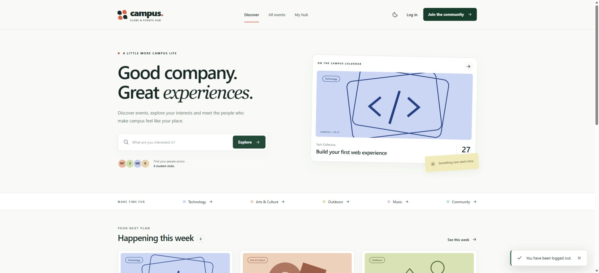
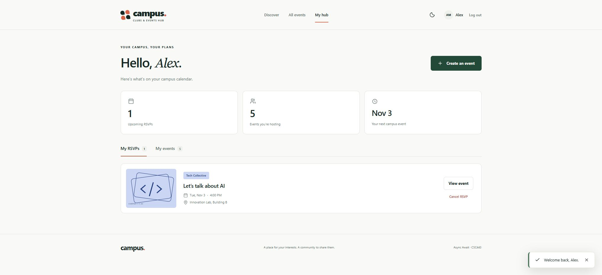

# Clubs & Events Hub

**CSC443 · Phase 1 · Team Async Await**

Mohammad Touka, Zeid, Mohammad Bliek, and Badih

Clubs & Events Hub is our assigned project topic. Students can discover campus events and RSVP. Event creators can publish, edit, and delete their own events.

[Live website](https://csc443-campus-hub-async-await-2026.mhmddddd.chatgpt.site/) · [GitHub repository](https://github.com/mhmmdtuka704-blip/-clubs-events-hub)

## Run locally

Install Node.js 24 and pnpm 11.25.0. From a terminal, run:

```sh
npm install --global pnpm@11.25.0
git clone https://github.com/mhmmdtuka704-blip/-clubs-events-hub.git clubs-events-hub
cd clubs-events-hub
pnpm install --frozen-lockfile
pnpm dev
```

Open the URL Vite prints, usually `http://127.0.0.1:5173/`.

```sh
pnpm test
pnpm format:check
pnpm build
pnpm preview
```

The production build is in `dist/`. GitHub Actions runs the format check, tests, and build on pushes to main and on pull requests.

## What you can do

| View              | Route                                  | Features                                                                                        |
| ----------------- | -------------------------------------- | ----------------------------------------------------------------------------------------------- |
| Homepage          | `/`                                    | See this week's events and browse clubs.                                                        |
| Event List        | `/events`                              | Search and combine club, date, and category filters.                                            |
| Event Details     | `/events/:eventId`                     | Read event information, open the host club, and RSVP or cancel.                                 |
| Club Details      | `/clubs/:clubId`                       | See the club profile and its events.                                                            |
| Create/Edit Event | `/events/new`, `/events/:eventId/edit` | Create an event or edit one you own. The form checks required fields, date, time, and capacity. |
| My Events & RSVPs | `/dashboard`                           | See your RSVPs and events. Cancel RSVPs or manage your own events.                              |
| Login             | `/login`                               | Sign in with a demo or newly registered account.                                                |
| Register          | `/register`                            | Create a mock account with email and password validation.                                       |

Start on **Log in** and pick Alex or Maya. Both use the demo password `Campus2026!`. They have different events and RSVPs. Try creating an event, finding it in the calendar, and editing or deleting it from **My hub**.

The navigation works across all pages. It has a menu on smaller screens and a light/dark switch. Forms have labels and show errors beside the relevant fields. You can use the keyboard to open event notes, switch dashboard tabs, and close the delete dialog.

## How the demo data works

| Entity | What it holds                                          |
| ------ | ------------------------------------------------------ |
| Clubs  | Club name, profile, and category                       |
| Events | Date, time, location, capacity, host club, and creator |
| Users  | Name, email, and demo login details                    |
| RSVPs  | The link between a user and an event                   |

The demo starts with six clubs, nine events, two users, and two RSVPs. Event dates are set relative to the day you open the app.

React state keeps the pages in sync. Creating or editing an event updates the calendar, club page, and dashboard. Deleting an event also clears its RSVPs. New accounts, events, RSVPs, and sign-in state reset on refresh. The app keeps the theme setting in local storage. Use a sample password if you register.

The frontend uses React, React Router, Tailwind CSS, and Vite. Reusable cards, fields, and layout components receive data through props. The tests cover rules such as ownership, duplicate RSVPs, capacity, and validation.

## Screenshots





[Event filters](docs/screenshots/events.png) · [Event details](docs/screenshots/event-details-rsvp.png) · [Club details](docs/screenshots/club.png) · [Event form](docs/screenshots/event-form.png) · [Login](docs/screenshots/login.png) · [Registration validation](docs/screenshots/register-validation.png) · [Mobile layout](docs/screenshots/mobile-home.png)

## Team responsibilities

Each team member owns two views. Mohammad Touka also coordinates how event and RSVP changes reach the dashboard.

| Team member    | Views                                   | Responsibilities                                                                   |
| -------------- | --------------------------------------- | ---------------------------------------------------------------------------------- |
| Mohammad Touka | Create/Edit Event and My Events & RSVPs | Event form validation, event management, and keeping the dashboard in sync.        |
| Zeid           | Event List and Event Details            | Search, filters, event information, and RSVP controls.                             |
| Mohammad Bliek | Homepage and Club Details               | This week's events, club profiles, and links from clubs to their events.           |
| Badih          | Login and Register                      | Mock accounts, form validation, and returning users to the right page after login. |

The table records the team's agreed page ownership. Individual implementation work is recorded through commits and pull requests as it is completed.

## Project notes

[Verification record](docs/TESTING.md) · [Requirements map](docs/REQUIREMENTS.md) · [Submission links](docs/SUBMISSION.md)
