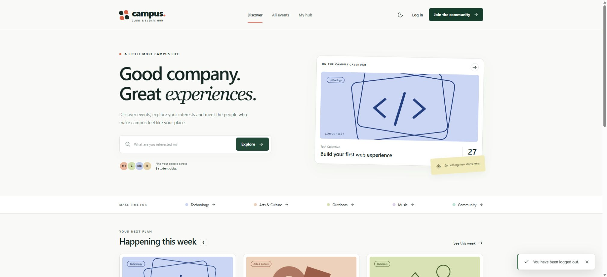
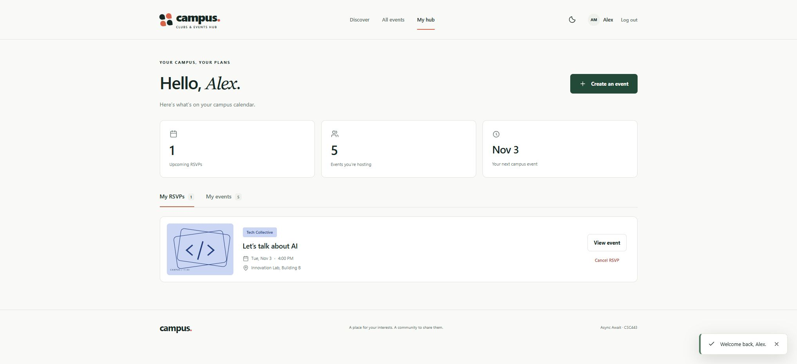
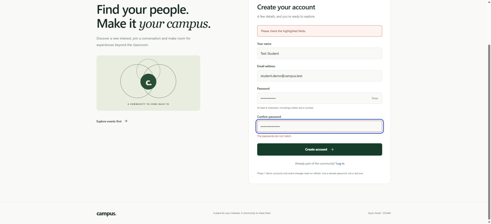

# Clubs and Events Hub

A complete CSC443 Phase 1 frontend for student clubs to publish events and students to discover activities and RSVP.

**Team:** Async Await  
**Members:** Mohammad Touka, Zeid, Mohammad Bliek and Badih  
**Course:** CSC443, Fall 2026

## Application and repository

- [Open the hosted application](https://csc443-campus-hub-async-await-2026.mhmddddd.chatgpt.site)
- The hosted application is public and accessible through its URL.
- [Public GitHub repository](https://github.com/mhmmdtuka704-blip/-clubs-events-hub)

## Run locally

Requirements: Node.js **22.12 or newer** (Node 24 recommended) and **pnpm 11.25.0**.

If pnpm is not installed:

```sh
npm install --global pnpm@11.25.0
```

From the project folder:

```sh
pnpm install --frozen-lockfile
pnpm dev
```

Open the Local URL printed by Vite, normally `http://127.0.0.1:5173/`.

For a production build and local production preview:

```sh
pnpm build
pnpm preview
```

To verify the source:

```sh
pnpm test
pnpm format:check
```

`pnpm format` applies the project's formatting rules. The lockfile fixes the dependency versions used by the working build.

## Try the complete demo

| Demo user   | Email              | Password      |
| ----------- | ------------------ | ------------- |
| Alex Morgan | `alex@campus.test` | `Campus2026!` |
| Maya Haddad | `maya@campus.test` | `Campus2026!` |

The Login page has buttons that fill these sample credentials. Alex and Maya own different events, making it easy to demonstrate user-specific dashboards and creator controls. Registration also works: it creates a mock account and logs the new user in automatically.

1. Browse events and combine search, club, category and date filters.
2. Open an event and log in when prompted. Login returns you to that event.
3. RSVP and verify the event appears in **My hub**. Cancel from the details page or dashboard.
4. Open **Create an event**, complete the form and publish it.
5. Check the new event in the calendar, its club page and **My events**.
6. Edit it, verify the updated details, then test the delete confirmation.
7. Log out and use the other demo account to verify that its content is different.

All accounts and content are fictional frontend demo data. Use a sample password when trying registration.

## Required views and routes

| Required view       | Route                                     | Main behaviour                                                          |
| ------------------- | ----------------------------------------- | ----------------------------------------------------------------------- |
| Homepage            | `/`                                       | Current week's events, search, club discovery and navigation            |
| Event List          | `/events`                                 | Combined search, club/category/date filters, reset and empty states     |
| Event Details       | `/events/:eventId`                        | Full details, club link, RSVP/cancel, availability and creator controls |
| Club Details        | `/clubs/:clubId`                          | Club information and related events                                     |
| Create/Edit Event   | `/events/new` and `/events/:eventId/edit` | One reusable, validated form with create and edit modes                 |
| My Events and RSVPs | `/dashboard`                              | Current user's RSVPs and created events, edit/delete/cancel actions     |
| Login               | `/login`                                  | Mock credential validation, demo accounts and return navigation         |
| Register            | `/register`                               | Validated account creation, duplicate-email checks and confirmation     |

Create and edit are two modes of one required view. Missing URLs and unavailable records also have useful fallback screens.

## Topic and primary data entities

Assigned topic: **Clubs & Events Hub**.

| Entity | Key relationships                                              |
| ------ | -------------------------------------------------------------- |
| Club   | `id`, descriptive information and a category                   |
| Event  | `clubId` links to its club; `creatorId` identifies its creator |
| User   | `id`, name, normalized email and a mock password               |
| RSVP   | `userId` and `eventId` link a student to an event              |

## Mock data and state behaviour

`src/data/seed.js` supplies six fictional clubs and nine events. Event dates are generated relative to the current local date, keeping the demonstration useful. `createInitialState` adds two sample users and two RSVPs.

`AppProvider` holds a single application state in React. Every page reads the same records. Adding or editing an event updates the shared collection; deleting an event removes its related RSVPs. Login changes the current user, so the dashboard derives that user's content. Registration adds an account for the current session.

`applyCommand` is a pure transaction layer shared by all mutations. It validates input, checks record relationships and ownership, prevents duplicate or over-capacity RSVPs and returns a new state without mutating the previous one. The provider applies sequential transactions against the latest state, including when two actions happen before the next render.

**Refresh behaviour:** mock accounts, events, RSVPs and login state reset on a full page refresh, as permitted by the Phase 1 brief. Normal client-side navigation preserves them. Only the light/dark preference is stored in localStorage. Filters are represented in URL search parameters.

Authentication and creator checks are frontend simulations. Phase 2 will need backend authentication, authorization and persistence.

## Validation and interaction

- Login checks required fields and mock credentials.
- Registration validates name, email, case-insensitive duplicate emails, password length, a letter/number requirement and password confirmation.
- Event forms validate required fields, text lengths, available clubs/categories, valid future dates/times, and a whole-number capacity from 1 to 500. Capacity cannot be reduced below the current attendee count.
- RSVPs require login, an available future event and a free place. Duplicate RSVPs are rejected.
- Deletion uses a native confirmation dialog. Cancelling the dialog preserves the event.
- All views share a persistent navbar and light/dark theme. Mobile navigation, expandable details, form feedback, success notifications and empty states provide visible interaction feedback.

## Architecture and code quality

Built with React 19, React Router 7, Tailwind CSS 4 and Vite 7. Functional components use hooks including `useState`, `useEffect`, `useRef` and `useCallback`. Reusable components receive data through props.

```text
src/
  components/  Layout, cards, artwork, icons, fields, auth guard and confirmation dialog
  context/     Shared application state, atomic command execution, theme and notices
  data/        Mock clubs and event seeds
  lib/         Pure filtering, date, validation, transaction and navigation functions
  pages/       The eight required views and fallback screens
tests/
  *.test.js    Business-rule tests using Node's built-in test runner
  fixtures/    Local responsive QA page; excluded from the production build
docs/
  screenshots/ Actual application screenshots
  TESTING.md   Verification record
  SUBMISSION.md Submission links and final team actions
```

Forms have visible labels, associated field errors and first-invalid-field focus. Navigation includes a skip link and route focus handling. Artwork has accessible descriptions, decorative icons are hidden from assistive technology, dashboard tabs support arrow keys, dialogs support Escape, and reduced-motion preferences are respected.

## Screenshots

### Homepage



### Dashboard and RSVP state



### Registration validation



Additional screenshots: [Event List](docs/screenshots/events.png), [Event Details and RSVP](docs/screenshots/event-details-rsvp.png), [Club Details](docs/screenshots/club.png), [Create/Edit form](docs/screenshots/event-form.png), [Login](docs/screenshots/login.png), [Delete confirmation](docs/screenshots/delete-confirmation.png), [Mobile layout](docs/screenshots/mobile-home.png), [Tablet layout](docs/screenshots/tablet-events.png).

All event artwork is original code-based SVG. No third-party image assets are required.

## Team ownership and contributions

Bucket ownership is **unassigned**, as requested by the team. Fill the primary owner and actual contribution summary after choosing the buckets. Each member should use their own Git identity, a feature branch and meaningful commits for their actual work.

| Bucket | Two views                                 | Shared responsibilities                                   | Primary owner |
| ------ | ----------------------------------------- | --------------------------------------------------------- | ------------- |
| A      | Homepage and Club Details                 | Shared layout, navigation, theme and mock-data foundation | Unassigned    |
| B      | Event List and Event Details              | Filters, event information and RSVP interaction           | Unassigned    |
| C      | Create/Edit Event and My Events and RSVPs | Event mutations, validation and dashboard integration     | Unassigned    |
| D      | Login and Register                        | Mock accounts, deployment and README assembly             | Unassigned    |

Team members to allocate: Mohammad Touka, Zeid, Mohammad Bliek and Badih. The final contribution summary must describe actual work and identify each member's two pages.

## Verification and deployment

See [the requirements map](docs/REQUIREMENTS.md), [the verification record](docs/TESTING.md) and [the submission checklist](docs/SUBMISSION.md).

The GitHub Actions workflow runs locked dependency installation, formatting checks, business-rule tests and a production build on pushes to main and pull requests. See the repository's Actions tab for hosted run results.

The Sites hosting manifest enables single-page application fallback for direct route visits. Netlify and Vercel configuration files are also included for those static hosting options. Build output is `dist/`; no backend or database deployment is needed for Phase 1.

## Technical references

- [React](https://react.dev/learn)
- [React Router declarative setup](https://reactrouter.com/start/declarative/installation)
- [Tailwind CSS with Vite](https://tailwindcss.com/docs/installation/using-vite)
- [Vite production builds](https://vite.dev/guide/build)
